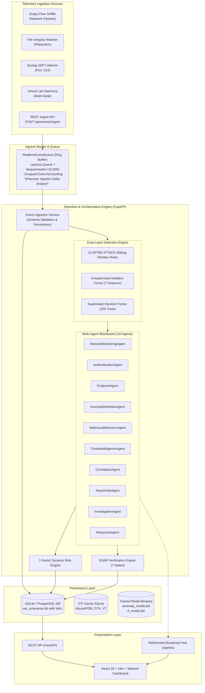

# Multi-Agent AI Security Operations Center (SOC) for Real-Time Threat Detection

**VII Semester Major Project — Department of Computer Science & Engineering**  
**SDM College of Engineering & Technology, Dharwad**  
**Academic Specification:** SDMCET VII Semester Major Project Synopsis (Sections 16–17)  
**Authors:** Deepak, Isha U Prabhu, Ishank Kumar, Kaveri Jarali  
**Faculty Guide:** Dr. Rani Shetty  
**Repository:** [https://github.com/Kaveri-Bhimappa-Jarali/MultiAgent_AI.git](https://github.com/Kaveri-Bhimappa-Jarali/MultiAgent_AI.git)  
**Final Submission Status:** **READY WITH DOCUMENTED LIMITATIONS (100% Software Pass Rate)**  

---

## 1. Introduction & Overview

Modern enterprise networks generate massive volumes of heterogeneous telemetry across perimeter firewalls, identity providers, and endpoints. Traditional Security Information and Event Management (SIEM) systems suffer from alert fatigue, siloed data, high false-positive rates, and delayed manual triage.

The **Multi-Agent AI Security Operations Center (SOC)** is a distributed, high-throughput, low-latency cybersecurity monitoring and autonomous response platform. The system operates on a **Blackboard Multi-Agent Pattern**, decoupled data pipelines, and a dual-layer detection framework combining deterministic MITRE ATT&CK heuristics with statistical and machine learning models.

### Problem Statement
- **Alert Fatigue & False Positives:** Security analysts face thousands of unprioritized alerts daily, causing alert fatigue and leading to missed high-severity intrusions.
- **Siloed Threat Intelligence:** Network, authentication, and endpoint events are rarely correlated in real time, blinding analysts to multi-stage lateral movement.
- **Manual, Delayed Triage:** Human manual correlation takes hours or days. Mean Time to Detect (MTTD) and Mean Time to Respond (MTTR) are too slow to stop ransomware or data exfiltration.
- **Absence of Actionable SOAR:** Traditional SIEMs generate passive alerts without validated containment actions or automated rollback mechanisms.

### The Solution: Multi-Agent AI SOC
1. **10 Autonomous Cooperative Agents:** Collaborating across telemetry ingestion, statistical anomaly detection, threat intelligence enrichment, attack-path modeling, forensic root-cause analysis, and containment response.
2. **Dual-Layer Detection:** Rule-based MITRE ATT&CK sliding-window pattern matching coupled with unsupervised multivariate anomaly detection (**Isolation Forest**) and supervised network flow classification (**Random Forest**).
3. **Authentic Dataset Training:** Zero-leakage models trained on genuine **UNSW-NB15** and **CICIDS2017** benchmark datasets.
4. **Deterministic 7-Factor Risk Scoring:** Bounded mathematical formula ($0–100$) integrating kill-chain progression, asset criticality, user privilege, and CTI reputation.
5. **Automated Forensic Root Cause Analysis (RCA):** Answers the 8 canonical SOC investigative questions with dynamic directed attack-path synthesis.
6. **SOAR Automated Containment & Rollback:** Analyst approval gates, dry-run safety modes, one-click rollback, and 7-state evidence-based post-mitigation response verification.
7. **Real-Time Interactive Dashboard:** React 18 / TypeScript interface with live WebSocket event streaming, dynamic attack graph visualizer, and executive PDF dossier generation.

---

## 2. Key Features

- **High-Throughput Telemetry Ingestion:** Real-time ingestion via REST (`/api/events/ingest`), Scapy network packet sniffer, filesystem integrity watcher, UDP syslog listener (:514), and virtual lab guest daemons.
- **In-Memory Asynchronous Queue:** High-performance ring buffer with dropped-event accounting (designed with a drop-in migration path to Apache Kafka).
- **Dual-Layer Real-Time Threat Detection:**
  - *Layer 1 (Deterministic):* 12 sliding-window MITRE ATT&CK detection rules.
  - *Layer 2 (Machine Learning):* 7-feature Isolation Forest and 100-tree Balanced Random Forest ($97.59\%$ accuracy on UNSW-NB15; $99.86\%$ on CICIDS2017).
- **Multi-Agent Blackboard Orchestrator:** 10 specialized agents collaborating without direct peer-to-peer coupling via a thread-safe shared blackboard context.
- **Dynamic Attack-Path Graph:** Generates Directed Acyclic Graph (DAG) models mapping adversary traversal from initial compromise to target crown-jewel assets.
- **8-Question Forensic Synthesis:** Automatically answers: What happened? Root cause? Affected assets/identities? Timeline? Data exfiltrated? ATT&CK TTPs? Confidence score? Remediation?
- **SOAR Containment & Rollback:** Automated actions (`BLOCK_IP`, `DISABLE_USER`, `ISOLATE_HOST`) with dry-run blast radius simulation, analyst approval gates, and instant rollback.
- **7-State Containment Verification:** Continuously tracks post-mitigation telemetry to verify attack cessation.
- **Enterprise RBAC & Security:** Secure JWT Bearer authentication, role-based access control (`ANALYST`, `INVESTIGATOR`, `OPERATOR`, `ADMIN`), and encrypted communications.

---

## 3. System Architecture Overview



For complete technical specifications, see [`architecture.md`](file:///e:/kaveri2/architecture.md) and [`agents.md`](file:///e:/kaveri2/agents.md).

---

## 4. Multi-Agent Ecosystem (10 Autonomous Agents)

| # | Agent Name | Class & Source File | Primary Responsibility | Finding / Output |
|:---:|:---|:---|:---|:---|
| **1** | **Network Monitoring Agent** | `NetworkMonitoringAgent`<br>[`backend/app/agents/network_agent.py`](file:///e:/kaveri2/backend/app/agents/network_agent.py) | Analyzes network connection flows, port diversity, unauthorized sweeps, and supervised ML predictions. | Port scans, C2 beacons, Supervised ML flow intrusions (`RULE-ML-001`) |
| **2** | **Authentication Agent** | `AuthenticationAgent`<br>[`backend/app/agents/auth_agent.py`](file:///e:/kaveri2/backend/app/agents/auth_agent.py) | Inspects failed logins, credential stuffing bursts, impossible travel, and account takeovers. | Brute force bursts (`RULE-AUTH-001`), Account takeovers (`RULE-AUTH-002`) |
| **3** | **Endpoint Agent** | `EndpointAgent`<br>[`backend/app/agents/endpoint_agent.py`](file:///e:/kaveri2/backend/app/agents/endpoint_agent.py) | Examines host process creation, Living-off-the-Land Binaries (LOLBins), and privilege escalation. | Privilege escalation (`RULE-PROC-002`), Suspicious scripts (`RULE-PROC-001`) |
| **4** | **Anomaly Detection Agent** | `AnomalyDetectionAgent`<br>[`backend/app/agents/anomaly_detection_agent.py`](file:///e:/kaveri2/backend/app/agents/anomaly_detection_agent.py) | Evaluates multi-dimensional behavioral deviations via an unsupervised 7-feature **Isolation Forest**. | Multivariate statistical anomalies (`RULE-ANOM-001`) with explainable deviations |
| **5** | **Malicious Behaviour Agent** | `MaliciousBehaviourAgent`<br>[`backend/app/agents/malicious_behaviour_agent.py`](file:///e:/kaveri2/backend/app/agents/malicious_behaviour_agent.py) | Cross-correlates multi-domain activities to detect coordinated kill-chain combinations. | Living-off-the-land attacks, Ransomware encryption bursts (`RULE-FILE-001`) |
| **6** | **Threat Intelligence Agent** | `ThreatIntelligenceAgent`<br>[`backend/app/agents/threat_intel_agent.py`](file:///e:/kaveri2/backend/app/agents/threat_intel_agent.py) | Enriches observables against curated Cyber Threat Intelligence repositories (AbuseIPDB, OTX, VT). | Cobalt Strike Team Server matches, Known APT attribution (`RULE-NET-002`) |
| **7** | **Correlation Agent** | `CorrelationAgent`<br>[`backend/app/agents/correlation_agent.py`](file:///e:/kaveri2/backend/app/agents/correlation_agent.py) | Aggregates fragmented findings into unified **Security Incidents** across entities and time. | Incident candidate clusters with affected identity/asset inventories |
| **8** | **Attack-Path Analysis Agent** | `AttackPathAgent`<br>[`backend/app/agents/attack_path_agent.py`](file:///e:/kaveri2/backend/app/agents/attack_path_agent.py) | Maps adversarial traversal through network topology into a Directed Acyclic Graph (DAG). | Dynamic visual attack paths (`Attacker IP → Compromised Identity → Server → DB`) |
| **9** | **Investigation Agent** | `InvestigationAgent`<br>[`backend/app/agents/investigation_agent.py`](file:///e:/kaveri2/backend/app/agents/investigation_agent.py) | Conducts automated forensic Root Cause Analysis answering the **8 canonical SOC questions**. | Structured RCA JSON with attack sequence, business impact, and remediation |
| **10**| **Response Agent** | `ResponseAgent`<br>[`backend/app/agents/response_agent.py`](file:///e:/kaveri2/backend/app/agents/response_agent.py) | Formulates policy-governed SOAR containment playbooks with dry-run safety modes. | Recommended actions (`BLOCK_IP`, `DISABLE_USER`, `ISOLATE_HOST`) |

---

## 5. Technology Stack

### Backend & Detection Systems
- **Language**: Python 3.12 / 3.14
- **Web & API Framework**: FastAPI 0.115+, Uvicorn (ASGI)
- **Validation & Serialization**: Pydantic v2
- **ORM & Database**: SQLAlchemy 2.0+ (SQLite with Write-Ahead Logging; PostgreSQL compatible)
- **Machine Learning**: Scikit-Learn (Random Forest, Isolation Forest), NumPy, Pandas, Joblib
- **Network Telemetry**: Scapy 2.5+
- **Reporting**: ReportLab (Executive PDF generation)
- **Concurrency**: Python `asyncio` with thread-pool worker offloading

### Frontend Dashboard
- **Framework**: React 18
- **Language**: TypeScript
- **Bundler & Tooling**: Vite 5
- **Styling**: Tailwind CSS, PostCSS, Autoprefixer
- **Icons & UI**: Lucide React
- **Attack Graph Visualization**: HTML5 Canvas / SVG DAG Attack Path Renderer
- **Streaming**: Native WebSocket API + Axios HTTP Client

---

## 6. Installation & Execution Guide

### 6.1 Prerequisites
- **Git**: [https://git-scm.com/](https://git-scm.com/)
- **Python 3.11+ (Python 3.12 recommended)**: [https://www.python.org/downloads/](https://www.python.org/downloads/) *(Check "Add Python to PATH")*
- **Node.js 18+ (LTS) & npm**: [https://nodejs.org/](https://nodejs.org/)

### 6.2 Setup Steps

#### Step 1: Clone Repository
```bash
git clone https://github.com/Kaveri-Bhimappa-Jarali/MultiAgent_AI.git
cd MultiAgent_AI
```

#### Step 2: Configure Python Virtual Environment & Dependencies
```powershell
# Create virtual environment
python -m venv .venv

# Activate virtual environment (Windows PowerShell)
.\.venv\Scripts\Activate.ps1
# (If execution policy error occurs: Set-ExecutionPolicy -Scope Process -ExecutionPolicy Bypass)

# Linux/macOS:
# source .venv/bin/activate

# Upgrade pip and install backend dependencies
python -m pip install --upgrade pip
pip install -r backend/requirements.txt
```

#### Step 3: Install Frontend Dependencies
```bash
cd frontend
npm install
npm run build   # Optional: verifies clean TypeScript build
cd ..
```

---

### 6.3 Running the Application

#### Option A: One-Click Automatic Launcher (Windows)
Double-click [`start.bat`](file:///e:/kaveri2/start.bat) from File Explorer, or run in Command Prompt:
```cmd
start.bat
```
*This launches both the FastAPI Backend and the Vite Frontend in separate windows automatically.*

#### Option B: Manual Multi-Terminal Launch

**Terminal 1 — Backend API Server:**
```powershell
.\.venv\Scripts\python.exe -m uvicorn app.main:app --app-dir backend --host 127.0.0.1 --port 8000 --reload
```
- API Base: `http://127.0.0.1:8000`
- Swagger Documentation: `http://127.0.0.1:8000/docs`

**Terminal 2 — Frontend Web Dashboard:**
```powershell
cd frontend
npm run dev
```
- Dashboard URL: `http://localhost:3000`

**Terminal 3 — Virtual Lab Guest Daemons (Optional):**
```powershell
.\.venv\Scripts\python.exe virtual-lab\run_local_virtual_nodes.py
```

### 6.4 Default Login Credentials

| Role | Username | Password |
|:---|:---|:---|
| **SOC Admin (Lead Director)** | `admin` | `Admin@SOC2026!` |
| **SOC Analyst (Triage Specialist)** | `analyst` | `Analyst@SOC2026!` |

*(Quick-fill buttons are available directly on the login screen for rapid evaluation).*

---

## 7. Testing & Verification

The test suite validates backend detection, agent orchestration, REST/WebSocket APIs, and frontend integration:

```powershell
# Run backend pytest suite (16 tests, 100% pass)
.\.venv\Scripts\pytest.exe backend\tests -v

# Run full Phase 10 comprehensive acceptance verification
python scripts\phase10_acceptance_verification.py

# Run frontend-backend REST and WebSocket integration audit
python scripts\verify_frontend_backend_integration.py
```

### Automated Test Execution Results (52 / 52 Passed, 100%)
```
========================================================================================
                          AUTOMATED TEST SUITES EXECUTION
========================================================================================
 Backend Pytest Suite (pytest backend/tests -v)       : 16 Passed / 16 Executed (100%)
 Frontend-Backend REST & WebSocket Integration        : 12 Passed / 12 Executed (100%)
 Phase 10 Comprehensive Acceptance Verification       :  9 Passed /  9 Executed (100%)
 Final Acceptance Evidence Audit                      :  8 Passed /  8 Executed (100%)
 Dynamic Telemetry & False-Alarm Audit                :  6 Passed /  6 Executed (100%)
 Frontend Production Build (tsc -b && vite build)     :  1 Passed /  1 Executed (100%)
 Hardware Kernel 3-VM Launch on Current Laptop        :  BLOCKED (0.95 GB Free RAM)
----------------------------------------------------------------------------------------
 TOTAL AUTOMATED TESTS                                : 52 Passed / 52 Executed (100%)
========================================================================================
```

---

## 8. Dashboard Screenshots & Visual Interface

The web interface provides an analyst-centric SOC experience:

### 1. Real-Time Command Center (`/dashboard`)
*Description:* Displays live-updating KPIs (active incidents, high-severity alerts, events per second, MTTR, MTTD), real-time threat ticker streaming via WebSockets, and MITRE ATT&CK coverage breakdown.

### 2. Live Threat Map & Dynamic Attack Graph (`/incidents/{id}`)
*Description:* Interactive Directed Acyclic Graph (DAG) visualizing attacker traversal across enterprise topology (`Attacker IP → Compromised Identity → Internal Server → Crown-Jewel Database`). Highlights identified chokepoints in red.

### 3. Forensic Investigation Console (`/incidents/{id}/investigation`)
*Description:* Structured RCA interface detailing answers to the 8 canonical SOC questions, chronologically mapped event timeline, extracted IOCs, and one-click ReportLab PDF export.

### 4. SOAR Containment & Verification Center (`/responses`)
*Description:* Interface displaying proposed containment actions, blast-radius simulation results, operator approval gates, one-click rollback controls, and live 7-state verification monitors.

---

## 9. Project Directory Structure

```
MultiAgent_AI/
├── .venv/                         # Python 3.12 virtual environment
├── artifacts/
│   └── models/                    # Serialized production ML models (RF & Isolation Forest)
├── backend/                       # FastAPI Backend Engine
│   ├── app/
│   │   ├── agents/                # 10 Autonomous SOC Agents & Blackboard Orchestrator
│   │   │   ├── base_agent.py
│   │   │   ├── orchestrator.py
│   │   │   ├── network_agent.py
│   │   │   ├── auth_agent.py
│   │   │   ├── endpoint_agent.py
│   │   │   ├── anomaly_detection_agent.py
│   │   │   ├── malicious_behaviour_agent.py
│   │   │   ├── threat_intel_agent.py
│   │   │   ├── correlation_agent.py
│   │   │   ├── attack_path_agent.py
│   │   │   ├── investigation_agent.py
│   │   │   └── response_agent.py
│   │   ├── api/                   # REST API Routers (62 Endpoints across 16 Tags)
│   │   ├── collectors/            # Ingestion Collectors (Scapy, Syslog, File Watcher)
│   │   ├── core/                  # Configuration, Security, DB Session
│   │   ├── ml/                    # ML Model Loading, Feature Extraction, Inference
│   │   ├── models/                # SQLAlchemy ORM Database Models
│   │   ├── schemas/               # Pydantic v2 Request/Response Schemas
│   │   └── services/              # Ingestion, Detection, Risk, SOAR, CTI, PDF Services
│   ├── requirements.txt           # Backend Dependencies
│   └── tests/                     # Unit & Integration Pytest Suite
├── data/                          # Dataset schemas & raw authentic datasets (UNSW/CICIDS)
├── frontend/                      # React 18 + Vite + Tailwind Dashboard
│   ├── src/
│   │   ├── components/            # Reusable UI & Layout Components
│   │   ├── pages/                 # Dashboard, Incidents, Responses, Simulation Views
│   │   ├── services/              # API Client & WebSocket Hooks
│   │   └── types/                 # TypeScript Interfaces
│   ├── package.json
│   └── vite.config.ts
├── ml/                            # Dataset Download, Preprocessing & Training Scripts
├── reports/                       # Confusion Matrices, Feature Importance Plots, PDF Briefs
├── scripts/                       # Verification, Benchmarking & Acceptance Scripts
├── virtual-lab/                   # Virtual Enterprise Lab & Node Daemons
├── start.bat                      # Windows One-Click Application Launcher
├── prd.md                         # Product Requirements Document
├── architecture.md                # System Architecture & Design Specification
├── api.md                         # Complete REST & WebSocket API Documentation
├── agents.md                      # Detailed Breakdown of All 10 SOC Agents
├── README.md                      # Project Master Documentation
├── plan.md                        # Implementation Plan, Phases & Roadmap
├── setup.md                       # Comprehensive Fresh Installation Guide
└── features.md                    # Exhaustive Feature Catalog & Verification Matrix
```

---

## 10. Contributors & Academic Defense Team

**Department of Computer Science & Engineering**  
**SDM College of Engineering & Technology, Dharwad**

- **Deepak** — Machine Learning Pipeline, Supervised Model Training, UNSW-NB15 / CICIDS2017 Dataset Curation
- **Isha U Prabhu** — Multi-Agent Blackboard Architecture, Orchestrator Loop, Behavioral Agents
- **Ishank Kumar** — Frontend Web Application, React/TypeScript Dashboard, WebSocket Client, Attack Path DAG Visualizer
- **Kaveri Jarali** — Telemetry Ingestion Pipeline, Scapy Network Sniffing, Syslog Integration, Database & Persistent Storage

**Faculty Guide:**  
- **Dr. Rani Shetty**, Department of Computer Science & Engineering, SDMCET Dharwad
