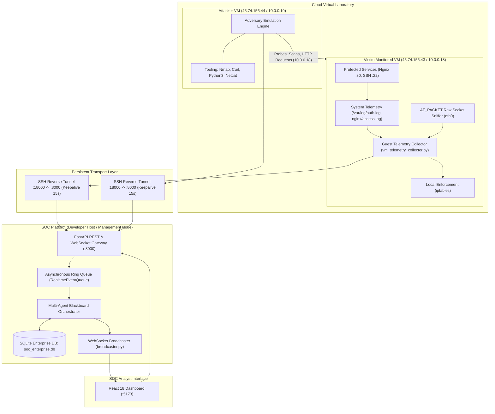
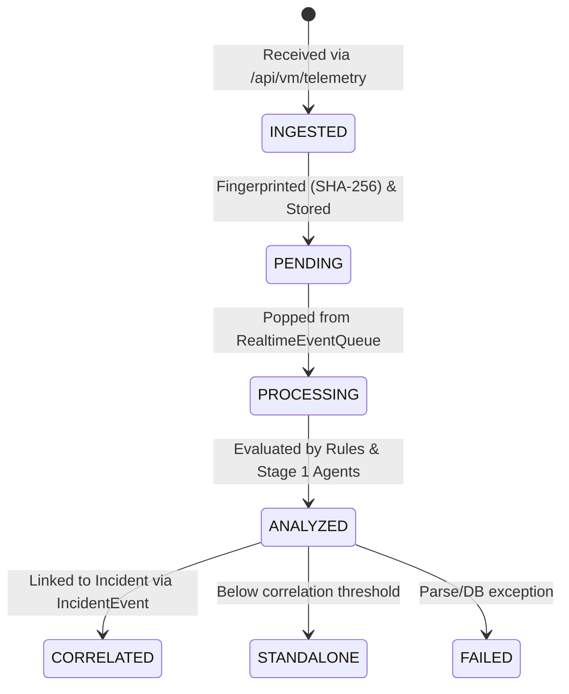
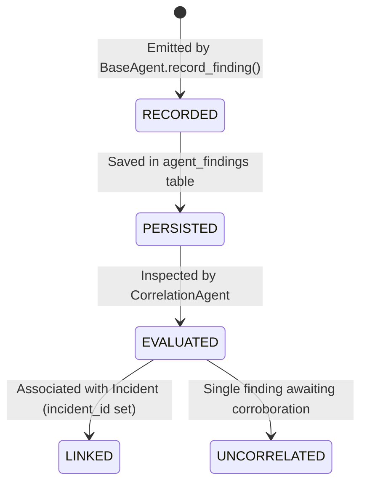
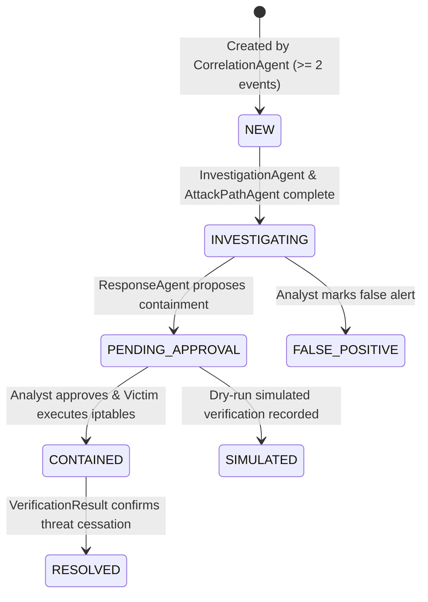
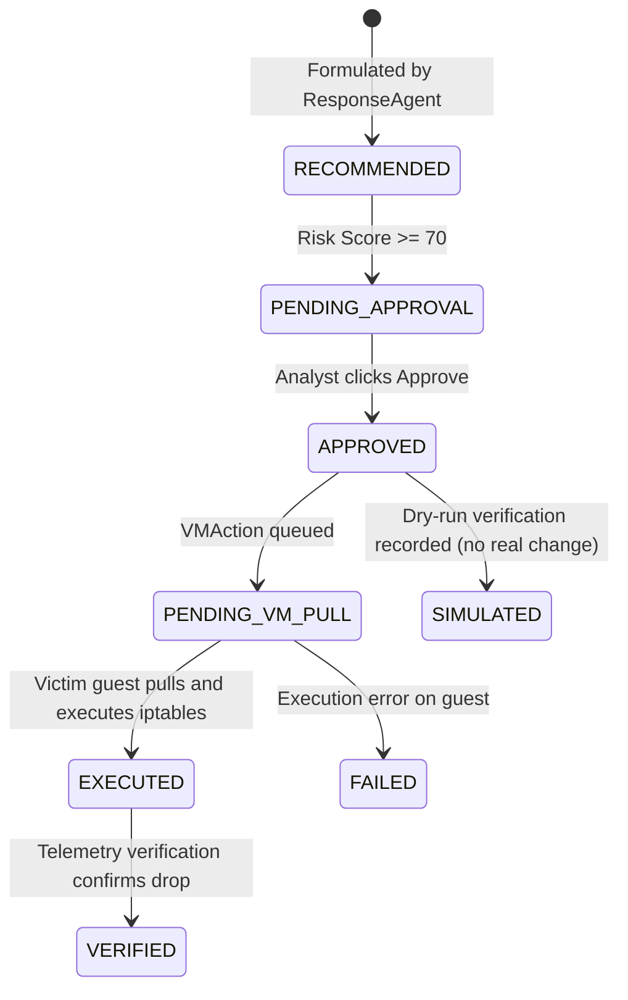

# TARGET ARCHITECTURE: Multi-Agent AI Security Operations Center (SOC)

**Document Version:** 1.0.0  
**Status:** Architectural Specification & Target Blueprint  
**Reference:** Academic Major Project Synopsis Sections 16–17  

---

## 1. Laboratory & Infrastructure Topology (Two-VM Model)

The target architecture enforces a strict **Two-VM Laboratory Model** where the external Attacker VM and monitored Victim VM interact over an isolated private cloud subnet, forwarding telemetry through resilient SSH tunnels to the host-based SOC platform:



### Component Status Legend
- **Existing & Preserved**: Attacker VM, Victim VM, FastAPI, SQLite DB, WebSocket Broadcaster.
- **Needs Modification**: 
  - `response_service.py` (adjust `BLOCK_IP` to execute directly on Victim VM `iptables` without requiring a 3rd Gateway VM).
  - Reverse SSH Tunnel startup (add auto-reconnect supervisor).
  - Frontend mappers (eliminate mock fallbacks).

---

## 2. End-to-End Security Data Flow

The complete flow from signal origination to defensive verification spans nine deterministic stages:

```mermaid
sequenceDiagram
    autonumber
    participant ATK as Attacker VM
    participant VIC as Victim VM (Collector)
    participant API as FastAPI Ingestion
    participant QUEUE as RealtimeEventQueue
    participant BB as MultiAgentSOCEngine
    participant DB as SQLite DB
    participant WS as WebSocket Broadcaster
    participant UI as React Dashboard

    Note over ATK, VIC: Stage 1: Adversary Activity Generation
    ATK->>VIC: Transmit probe (e.g. invalid SSH user login or port sweep)
    VIC->>VIC: Log to /var/log/auth.log or capture TCP SYN packet

    Note over VIC, API: Stage 2: Telemetry Ingestion & Deduplication
    VIC->>API: POST /api/vm/telemetry (JSON payload via :18000 tunnel)
    API->>API: Compute SHA-256 fingerprint & check duplicates
    API->>DB: INSERT into security_events (status: PENDING)
    API->>QUEUE: Enqueue event_id

    Note over QUEUE, BB: Stage 3: Detection Rules & Agent Orchestration
    QUEUE->>QUEUE: evaluate_event_with_rolling_window (MITRE Rules)
    QUEUE->>BB: dispatch_event_driven_pipeline(event, findings)

    Note over BB: Stage 4: Domain & Intelligence Agents
    BB->>BB: Stage 1: AuthAgent / NetworkAgent / EndpointAgent
    BB->>BB: Stage 2: AnomalyDetectionAgent / MaliciousBehaviourAgent / ThreatIntelAgent
    BB->>DB: INSERT into agent_findings

    Note over BB, DB: Stage 5: Correlation & Clustering
    BB->>BB: Stage 3: CorrelationAgent (evaluates >= 2 events + >= 2 findings)
    alt Criteria Met (Genuine Multi-Event Progression)
        BB->>DB: INSERT / UPDATE incidents, incident_events, incident_findings
        Note over BB, DB: Stage 6: Downstream Investigation & Attack-Path
        BB->>BB: Stage 4: AttackPathAgent (synthesize DAG JSON)
        BB->>BB: Stage 4: InvestigationAgent (synthesize 8 canonical SOC answers)
        BB->>BB: Stage 4: ResponseAgent (formulate ResponseActions)
        BB->>DB: UPDATE incidents (ai_summary, attack_path_json, risk_score)
        BB->>DB: INSERT into response_actions
        BB->>WS: Broadcast INCIDENT_CREATED / INCIDENT_UPDATED
    else Single Event / Unrelated Probe
        BB->>BB: Leave un-correlated; finding remains isolated alert
    end

    Note over WS, UI: Stage 7: Real-Time Visualization
    WS->>UI: Fan-out WebSocket payload (Zero mock fallbacks)
    UI->>UI: Render live alerts, incident cluster, DAG, and RCA answers
```

---

## 3. The Ten Specialized Agents: Responsibilities & Dependencies

```mermaid
graph TD
    subgraph INGESTION["Stage 1: Domain Telemetry Ingestion Agents (Parallel)"]
        AG1["Agent 1: NetworkMonitoringAgent<br/><b>Role:</b> Network Flow & Scanning Specialist<br/><b>Inputs:</b> Traffic events, port diversity, ML flow feats<br/><b>Outputs:</b> Port Sweep, C2 Beaconing Findings"]
        AG2["Agent 2: AuthenticationAgent<br/><b>Role:</b> Identity & Access Specialist<br/><b>Inputs:</b> auth.log events, failed password attempts<br/><b>Outputs:</b> Brute Force, Account Takeover Findings"]
        AG3["Agent 3: EndpointAgent<br/><b>Role:</b> Host & EDR Specialist<br/><b>Inputs:</b> Process execution, file access, sudo audit<br/><b>Outputs:</b> PrivEsc, Shadow Copy, Script Execution Findings"]
    end

    subgraph INTELLIGENCE["Stage 2: Intelligence & Outlier Analysis Agents (Parallel)"]
        AG4["Agent 4: AnomalyDetectionAgent<br/><b>Role:</b> Statistical Deviation Specialist<br/><b>Inputs:</b> 7-feature scaled vector, Isolation Forest model<br/><b>Outputs:</b> Multivariate Outlier Scores & Findings"]
        AG5["Agent 5: MaliciousBehaviourAgent<br/><b>Role:</b> Threat Behavior Specialist<br/><b>Inputs:</b> Aggregated cross-domain findings<br/><b>Outputs:</b> Kill-chain progression findings"]
        AG6["Agent 6: ThreatIntelligenceAgent<br/><b>Role:</b> CTI Enrichment Specialist<br/><b>Inputs:</b> Extracted IPs, domains, SHA-256 hashes<br/><b>Outputs:</b> Reputation scores & threat actor attribution"]
    end

    subgraph CORRELATION["Stage 3: Spatial-Temporal Fusion Engine (Sequential)"]
        AG7["Agent 7: CorrelationAgent<br/><b>Role:</b> Alert Fusion & Incident Synthesizer<br/><b>Strict Invariants:</b><br/>• Requires >= 2 distinct events & >= 2 findings<br/>• 300s-900s operational window<br/>• Common entity anchor (IP, Host, User)<br/>• Idempotent update without duplicate links<br/><b>Outputs:</b> Correlated Incident Dossier"]
    end

    subgraph DOWNSTREAM["Stage 4: Downstream Investigation & SOAR Response (Sequential)"]
        AG8["Agent 8: AttackPathAgent<br/><b>Role:</b> Topology Graph Modeler<br/><b>Outputs:</b> Directed Acyclic Graph (DAG) JSON"]
        AG9["Agent 9: InvestigationAgent<br/><b>Role:</b> Root Cause Synthesizer<br/><b>Outputs:</b> 8 Canonical SOC Answers & Timeline"]
        AG10["Agent 10: ResponseAgent<br/><b>Role:</b> SOAR Containment Orchestrator<br/><b>Outputs:</b> Gated Response Actions (BLOCK_IP, ISOLATE_HOST)"]
    end

    INGESTION --> INTELLIGENCE
    INTELLIGENCE --> CORRELATION
    CORRELATION -->|Established Incidents Only| DOWNSTREAM
```



---

## 4. Lifecycles & State Transitions

### 4.1 Security Event Lifecycle


### 4.2 Agent Finding Lifecycle


### 4.3 Incident Lifecycle


### 4.4 SOAR Response Action Lifecycle


---

## 5. Required API & Database Schema Adjustments

### Database Models (`soc_enterprise.db`)
1. **Preserve Existing Structure**: All 21 tables (`security_events`, `agent_findings`, `incidents`, `incident_events`, `incident_findings`, `response_actions`, `verification_results`, `vm_nodes`, `vm_actions`) are properly normalized with foreign keys and cascade rules.
2. **`vm_nodes` Table Realignment**:
   - Primary Endpoint: `vm-endpoint-01` (`10.0.0.18`, role `ENDPOINT`).
   - Attacker Node: `vm-attacker-01` (`10.0.0.19`, role `ATTACKER`).
   - Server Node `vm-server-01` (`192.168.56.15`): Retained in migrations for unit tests, but filtered from production views.

### API & Service Adjustments
1. **`response_service.py`**:
   - Change `BLOCK_IP` enforcement logic: Instead of requiring a non-existent `GATEWAY` node, dispatch the firewall rule directly to `vm-endpoint-01` (`iptables -I INPUT -s <target_ip> -j DROP`). This enables genuine 2-VM containment.
2. **`orchestrator.py`**:
   - Remove duplicate `agent_results.append(corr_res)`.
3. **Frontend Mappers & Hooks**:
   - In `incidentMapper.js`: Read `affected_ips[0]`, `title`, and `ai_summary` directly from the backend response. Remove all hardcoded fallbacks (`198.51.100.23`, `Sarah Chen`, synthetic timelines).
   - In `useLiveEvents.js`: Remove fake fallback `correlationId: 'INC-2026-001'`.
   - In `Dashboard.jsx`: Calculate `correlatedCount` as the sum of unique contributing events across incidents rather than total incident count.
