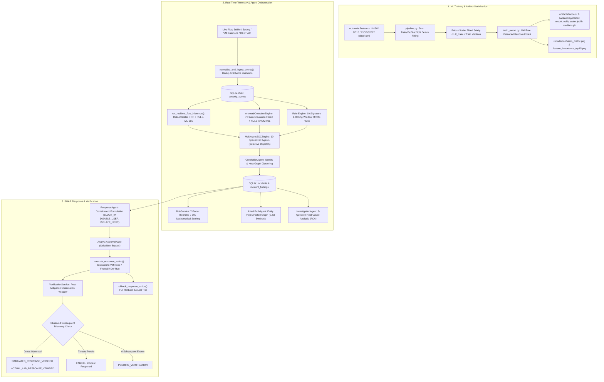

# DATA AND MODEL FLOW ARCHITECTURE

**Project:** Multi-Agent AI Security Operations Center (SOC) for Real-Time Threat Detection  
**Academic Specification:** SDMCET VII Sem CSE Major Project Synopsis (Sections 16–17)  
**Authors:** Deepak, Isha U Prabhu, Ishank Kumar, Kaveri Jarali  
**Faculty Guide:** Dr. Rani Shetty  
**Updated:** 2026-11-01  

---

## 1. High-Level Data Lifecycle

The Multi-Agent SOC processes data across three distinct lifecycle streams:
1. **Model Training & Artifact Persistence (Offline / Batch Pipeline)**
2. **Real-Time Telemetry Ingestion & Autonomous Agent Orchestration (Online Ingestion)**
3. **SOAR Containment Execution & Post-Response Verification (Defensive Loop)**

---

## 2. Machine Learning Training & Inference Flow

### 2.1 Zero-Leakage Preprocessing & Training
1. **Authentic Dataset Acquisition:** Benchmark datasets ([UNSW-NB15](file:///c:/Users/kaver/MultiAgent_AI/data/raw/unsw_nb15/UNSW_NB15_training-set.csv) with 82,332 records and [CICIDS2017](file:///c:/Users/kaver/MultiAgent_AI/data/raw/cicids2017/Friday-WorkingHours-Afternoon-PortScan.pcap_ISCX.csv) with 286,467 records) are loaded from `data/raw/`.
2. **Leak-Free Preprocessing Pipeline ([`ml/preprocessing/pipeline.py`](file:///c:/Users/kaver/MultiAgent_AI/ml/preprocessing/pipeline.py)):**
   - Stratified train/val/test splitting (`random_state=42`) is executed **strictly before** any transformations.
   - `RobustScaler` is fitted solely on `X_train` and transforms `X_val` and `X_test`.
   - Feature medians are computed solely from `X_train` for missing value imputation.
   - Infinite and NaN values are clipped; target-derived and identifier columns are excluded.
3. **Supervised Model Training ([`ml/training/train_model.py`](file:///c:/Users/kaver/MultiAgent_AI/ml/training/train_model.py)):**
   - Trains a 100-estimator `RandomForestClassifier` with balanced class weights.
   - Evaluates on held-out test split:
     - UNSW-NB15: **97.59% Accuracy, 95.37% Precision, 99.50% Recall, 97.39% F1, 3.97% FPR**.
     - CICIDS2017: **99.86% Accuracy, 77.78% Precision, 100.00% Recall, 87.50% F1, 0.14% FPR**.
   - Generates visual artifacts in `reports/` (`*_confusion_matrix.png`, `*_feature_importance_top15.png`).
   - Persists versioned artifacts in `artifacts/models/` and runtime copies in `backend/app/data/`.

### 2.2 Real-Time Online Inference Flow
When live network flow events enter the SOC:
1. `extract_flow_features_from_event()` parses raw flow attributes (`dur`, `spkts`, `dpkts`, `sbytes`, `dbytes`, `sttl`, `dttl`, etc.).
2. `run_realtime_flow_inference()` normalizes features with `supervised_scaler.joblib`, imputes missing attributes with `supervised_medians.pkl`, and invokes `predict_proba()`.
3. Rule `RULE-ML-001` (Supervised Flow Intrusion Detection) evaluates attack probability:
   - $P \ge 0.50 \implies$ triggers `MALICIOUS INTRUSION` finding with assigned severity (`HIGH` or `CRITICAL`).
4. Event-level Isolation Forest evaluates behavioral deviations via `RULE-ANOM-001`.
5. Findings are ingested into `MultiAgentSOCEngine` for correlation, risk assessment, and incident creation.

---

## 3. Real-Time Telemetry & Collector Architecture

The SOC features five concurrent ingress mechanisms managed by `CollectorManager`:
1. **Live Network Flow Sniffer ([`network_flow_sniffer.py`](file:///c:/Users/kaver/MultiAgent_AI/backend/app/services/collectors/network_flow_sniffer.py)):** Captures live packet flows via Scapy when elevated, safely falling back to socket monitoring when unprivileged.
2. **File Watcher Collector ([`file_watcher_collector.py`](file:///c:/Users/kaver/MultiAgent_AI/backend/app/services/collectors/file_watcher_collector.py)):** Checkpointed non-blocking tail of auth and syslog files.
3. **UDP Syslog Collector ([`syslog_collector.py`](file:///c:/Users/kaver/MultiAgent_AI/backend/app/services/collectors/syslog_collector.py)):** Asynchronous UDP receiver on port 5514.
4. **Virtual Lab Guest Agent Ingress ([`virtual_lab.py`](file:///c:/Users/kaver/MultiAgent_AI/backend/app/api/virtual_lab.py)):** Authenticated REST endpoint for guest VM heartbeats and telemetry with offline buffering.
5. **FastAPI REST Gateway (`/api/events/ingest`):** Standard authenticated ingestion endpoint for external SIEMs and scripts.

---

## 4. 0–100 Incident Risk Scoring Formula

The risk score is calculated deterministically via `calculate_incident_risk()` in `backend/app/services/risk_service.py`:

$$\text{Risk} = \text{clamp}\left( \left[ (S_{\text{prog}} \cdot C_{\text{det}} \cdot M_{\text{asset}} \cdot M_{\text{user}}) + B_{\text{cti}} + B_{\text{vol}} \right] \cdot U_{\text{factor}}, 0, 100 \right)$$

Where:
- $S_{\text{prog}} \in [10, 95]$: Base score from MITRE ATT&CK kill-chain stage (Reconnaissance=25, Initial Access=45, Execution=60, Privilege Escalation=80, Exfiltration=95).
- $C_{\text{det}} \in [0.5, 1.0]$: Confidence factor derived from ML probability and rule confidence.
- $M_{\text{asset}} \in [0.9, 1.5]$: Asset criticality multiplier (DC/Database=1.5x, Critical Server=1.3x, Standard=1.0x).
- $M_{\text{user}} \in [1.0, 1.4]$: Identity privilege multiplier (Domain Admin=1.4x, Root=1.3x, Standard=1.0x).
- $B_{\text{cti}} \in \{0, 15\}$: CTI Threat match bonus (+15 if confirmed APT/C2 match).
- $B_{\text{vol}} = \min(15, \lfloor 5 \cdot \log_2(\text{events} + 1) \rfloor)$: Entity volume bonus bounded to 15 to prevent double-counting.
- $U_{\text{factor}} \in [0.92, 1.0]$: Uncertainty discount factor (0.92 applied to single-source telemetry).
