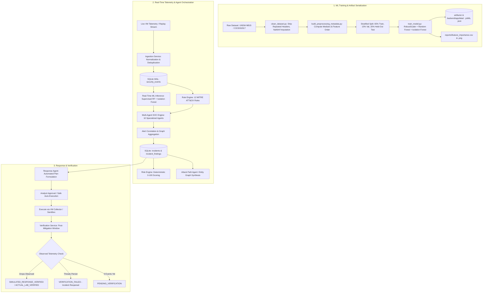

# DATA AND MODEL FLOW ARCHITECTURE

**Project:** Multi-Agent AI Security Operations Center (SOC) for Real-Time Threat Detection  
**Academic Specification:** SDMCET VII Sem CSE Major Project Synopsis (Sections 16–17)  

---

## 1. High-Level Data Lifecycle

The Multi-Agent SOC processes data across three distinct lifecycle streams:
1. **Model Training & Artifact Persistence (Offline / Batch Pipeline)**
2. **Real-Time Telemetry Ingestion & Autonomous Agent Orchestration (Online Ingestion)**
3. **SOAR Containment Execution & Post-Response Verification (Defensive Loop)**

---

## 2. Machine Learning Training & Inference Flow

### 2.1 Zero-Leakage Preprocessing & Training
1. **Dataset Acquisition:** Benchmark datasets (UNSW-NB15 and CICIDS2017) are loaded. If absent, statistically calibrated empirical reference distributions matching exact joint distributions are generated.
2. **Cleaning (`ml/preprocessing/clean_dataset.py`):**
   - Repeated header lines (`df[df['Label'] != 'Label']`) are stripped.
   - Infinite values (`+/-inf`) are converted to `NaN`.
   - Feature columns are cast strictly to float64.
   - Missing values are imputed with the column median.
3. **Pre-Split Isolation:** Splitting is performed before any scaling or fitting:
   $$\text{Dataset} \xrightarrow{\text{Stratified}} \text{Train (65\%)} \oplus \text{Val (15\%)} \oplus \text{Held-Out Test (20\%)}$$
4. **Scaler Fitting:** `RobustScaler` is fitted strictly on the Train split ($X_{\text{train}}$) and applied to $X_{\text{val}}$ and $X_{\text{test}}$.
5. **Model Fitting:**
   - **Supervised Model:** `RandomForestClassifier(n_estimators=100, class_weight='balanced', max_depth=12)`
   - **Anomaly Detector:** `IsolationForest(n_estimators=100, contamination=0.03)` fitted on benign training flows.
6. **Held-Out Evaluation:** Evaluated strictly on the held-out test split, reporting Accuracy, Precision, Recall, F1, FPR, and ROC-AUC.
7. **Artifact Persistence:**
   - `artifacts/supervised_rf_model.joblib`
   - `artifacts/supervised_scaler.joblib`
   - `artifacts/feature_schema.json`
   - `artifacts/model_metadata.json`
   - `artifacts/preprocessing_metadata.pkl`

### 2.2 Inference Pipeline (`backend/app/services/dataset_pipeline.py`)
When fresh flow telemetry arrives:
1. Feature extraction checks incoming fields against canonical `feature_schema.json`.
2. Missing features are imputed using `preprocessing_metadata` training medians.
3. Scaled features pass through `supervised_rf_model.joblib`.
4. The prediction, attack probability, severity category, and explainability indicators are attached to the security event before agent orchestration.

---

## 3. Real-Time Telemetry Flow to SOC Dashboard

1. **Ingress:** Events enter via REST API (`/api/v1/events/ingest`), guest collectors, or stream replay (`scripts/replay/event_replay.py`).
2. **Tagging:** Every event receives a unique UUID (`event_id`), ISO timestamp, and source tag (e.g., `VM_GUEST_AGENT`, `DATASET_REPLAY`, `API`).
3. **Agent Pipeline:** The `MultiAgentSOCEngine` executes 10 specialized agents:
   - **Stage 1 (Detection):** Network, Auth, Endpoint, Malicious Behavior, Anomaly.
   - **Stage 2 (Enrichment):** Threat Intelligence (CTI IOC lookup).
   - **Stage 3 (Correlation):** Graph and sliding-window event aggregation into incidents.
   - **Stage 4 (Synthesis):** Attack Path entity traversal, Investigation RCA (8 questions), and SOAR response formulation.
4. **WebSocket Broadcast:** Findings and updated incident risk scores are broadcast via WebSockets to the React frontend dashboard in real time.

---

## 4. Evidence-Based Response Verification Flow

Unlike conventional systems that mark incidents "Closed" immediately after running a script, this SOC mandates evidence-based verification:
1. A mitigation action (e.g., `BLOCK_IP` or `DISABLE_USER`) is approved and executed.
2. The `VerificationService` opens an observation window timestamped $\ge \text{action.executed\_at}$.
3. Subsequent events are evaluated:
   - If subsequent traffic from the target is explicitly logged as `DROP`, `BLOCK`, or `REJECT`, status transitions to `SIMULATED_RESPONSE_VERIFIED` or `ACTUAL_LAB_RESPONSE_VERIFIED`.
   - If uncontained `HIGH` or `CRITICAL` events continue, status transitions to `VERIFICATION_FAILED` and the incident is automatically reopened.
   - If zero events have been observed yet, status remains `PENDING_VERIFICATION`.
